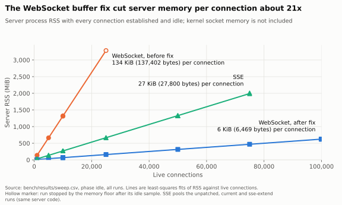
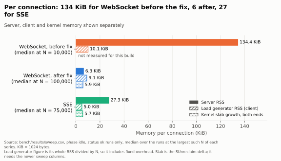
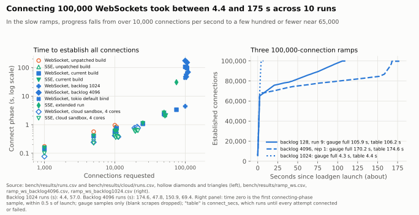
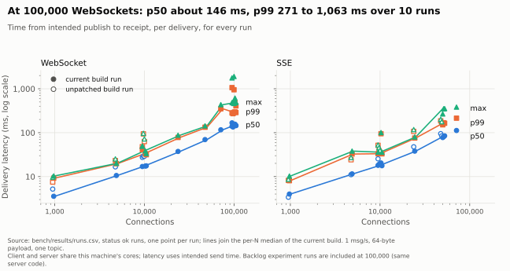

# Scaling hydrant to 100,000 connections

On one 32-core WSL2 machine, hydrant accepted up to 99,982 of 100,000 requested idle WebSocket subscribers (99,691 in the worst of ten runs) and lost no deliveries among the connections that were established: 0 of the 33,360,760 deliveries expected over all 41 completed runs were missing. The 18 to 309 connections per 100,000-connection run that never connected are not part of that loss figure. The server process used about 6,470 bytes of RSS per requested WebSocket connection, 618 MiB in total at 100,000. SSE costs about 27,700 to 28,000 bytes per connection and reached 75,000 requested (74,983 established, one run); a 100,000 SSE run was stopped by the benchmark's memory floor before it connected. One thing needs attention before you trust the result: the connect phase at 100,000 connections took between 4.4 and 175 seconds depending on the run, and I do not know why.

<picture>
  <source media="(prefers-color-scheme: dark)" srcset="img/rss-vs-connections-dark.svg">
  
</picture>

| Server build and transport | Largest N completed | Established | Server RSS per requested connection | Latency p50 / p99 | Connect phase |
| --- | --- | --- | --- | --- | --- |
| WebSocket, before buffer fix | 10,000 (3 runs) | 9,999 each | 137,275 to 137,616 bytes | 27 to 29 ms / 48 to 94 ms | 0.83 to 0.96 s |
| WebSocket, after buffer fix | 100,000 (10 runs) | 99,691 to 99,982 | 6,460 to 6,483 bytes (10 runs) | 135 to 168 ms / 271 to 1,063 ms | 4.4 to 175 s |
| SSE | 75,000 (1 run) | 74,983 | 28,005 bytes | 112 ms / 214 ms | 30.7 s |
| SSE | 50,000 (5 runs) | 49,979 to 49,988 | 27,689 to 27,707 bytes | 78 to 95 ms / 151 to 186 ms | 2.0 to 2.8 s |

The before-fix WebSocket server also produced an idle sample at 25,000 connections (137,472 bytes each) before the memory floor stopped that run, so 25,000 is where this machine ran out of RAM for that build, not a measured server limit. All figures come from `bench/results/runs.csv` and `bench/results/sweep.csv`; the 10 runs at 100,000 WebSocket connections include the follow-up experiments described below, which differ in the listen backlog and, as the limits section explains, in the exact binary. "Established" is what the load generator got connected out of the requested N; loss is counted over established connections only.

## What was measured and how

The machine is an Intel i9-13980HX (32 logical cores) with 15.5 GiB of RAM under WSL2, kernel 6.18.33.1-microsoft-standard-WSL2, rustc 1.96.0, release builds. It was also the author's working machine and was in use during the runs, which is why memory deltas from the whole system are noisy and why the benchmark refuses to run below a floor of 1.5 GiB available. The server and the load generator share the machine and its cores, and all traffic is loopback. The run date is in `bench/results/environment.json`.

Each step starts a fresh server process, so memory retained from an earlier step cannot affect a number. The load generator opens N subscribers on one topic, waits until the server's own connection gauge equals the number the client established, holds them idle, then publishes open-loop at 1 message per second for 20 seconds with a 64-byte payload. Every subscriber receives every message, so N connections means N deliveries per second. Latency is measured from the message's intended send time, not from when the publisher actually sent it, so a stalled server shows up as latency instead of being hidden. The sweep covers 1,000, 5,000, 10,000, 25,000, 50,000, 75,000 and 100,000 connections, with repeats at 10,000 and at the largest N reached. All 47 recorded runs are kept: 41 completed, 4 were aborted by the memory floor and 2 were skipped because the predicted memory did not fit.

"RSS per connection" is the server process's resident set at the idle sample, minus its resident set before any connection, divided by the requested N (dividing by the established count instead changes the figure by at most 0.3 percent), read from `/proc/<pid>/status`. It does not include kernel socket memory. The kernel side shows up as growth in unreclaimable slab (the `SUnreclaim` line of `/proc/meminfo`), which covers both ends of each loopback connection: about 5,884 to 6,309 bytes per connection for WebSocket at 100,000 (10 runs) and 6,159 to 6,236 for SSE at 50,000 (3 runs; the slab column was not recorded in the other two). The load generator's own RSS adds about 9,300 bytes per WebSocket connection and 5,200 per SSE connection (its whole RSS divided by N, so it includes fixed overhead). The system-wide drop in `MemAvailable` per connection at 100,000 WebSocket connections was 14,534 to 27,912 bytes (10 runs), which is consistent with those three parts but noisy. TCP buffer memory reported in `/proc/net/sockstat` stayed near zero because idle loopback sockets hold no buffered data.

<picture>
  <source media="(prefers-color-scheme: dark)" srcset="img/memory-per-connection-dark.svg">
  
</picture>

## Getting past the port limit without root

A TCP connection needs a unique combination of source address, source port, destination address and destination port. With one destination address and port the ephemeral port range caps connections; on this machine `net.ipv4.ip_local_port_range` is 40525 to 44620, which is 4,096 ports. Every address in 127.0.0.0/8 is local, so the server listens on `0.0.0.0` and the load generator spreads its connections round-robin over 64 loopback destination addresses (`--spread-loopback 64`), each with its own pool of source ports. Closed connections sit in TIME_WAIT for 60 seconds and keep their tuple, so every run uses a fresh /24 block of addresses. No system setting was changed. With root you would instead widen the port range, raise `net.core.somaxconn` and `tcp_max_syn_backlog`, and raise the file limits; `bench/README.md` lists the commands, none of which were applied here.

## Finding 1: a 128 KiB default buffer per WebSocket

As merged, the server cost 137,275 to 137,616 bytes of RSS per WebSocket connection. The tungstenite version in `Cargo.lock` (0.29.0) defaults both `read_buffer_size` and `write_buffer_size` to 128 KiB, and axum's `WebSocketUpgrade` starts from `Default::default()` for that config. Setting `read_buffer_size(4096)` and `write_buffer_size(0)` in `crates/server/src/routes/ws.rs` brought the cost to 6,460 to 6,483 bytes at 100,000 connections (10 runs), about 21 times less. The fitted difference between the two builds, 130,933 bytes, is almost exactly 128 KiB (131,072), so the read buffer accounts for essentially all of it. RSS barely changed between the idle and load samples of the unpatched build (61 to 69 bytes per connection at N = 10,000 in 3 runs, 94 and 82 at 1,000 and 5,000 in one run each), so these runs give no direct evidence about the write buffer; at 1 message per second it was apparently never filled. A test (`websocket_delivers_a_max_size_payload_byte_exact` in `crates/server/tests/fanout.rs`) checks that a 65,536-byte payload still arrives intact with the smaller buffers.

## Finding 2: SSE costs about four times as much as WebSocket after the fix

Per connection the server's RSS is 27,689 to 28,005 bytes for SSE against about 6,480 for the fixed WebSocket handler, a ratio of about 4.3. SSE reached 50,000 in five runs and 75,000 in one. A 100,000 run was started and aborted by the memory floor at 1,471 MiB available while connecting, so SSE at 100,000 is untested, not failed. Why SSE costs more is not measured here. A plausible but unchecked explanation is that an SSE response stays inside hyper's HTTP/1 connection state, with its buffers and a keep-alive timer, while a WebSocket drops out of that machinery after the upgrade; the SSE handler also keeps a channel and a spawned pump task per stream. Treat that as a hypothesis to test with a heap profile.

## Finding 3: the connect-phase cliff, and what was not explained

Up to 75,000 WebSocket connections the connect phase scales smoothly: 3.3 s at 75,000. At 100,000 it took 4.4, 43.8, 47.8, 57.1, 69.4, 97.0, 105.0, 106.2, 150.9 and 174.6 seconds in ten runs. SSE at 75,000 took 30.7 s (8,239 SYN retransmissions), against 2.0 to 2.8 s at 50,000, so the effect is not specific to WebSocket. In the slow ramps (`ramp_ws.csv`, `ramp_ws_backlog4096.csv`, `ramp_ws_tokio-default-bind.csv`) about 65,000 connections are up within 4 to 11 seconds and the remainder crawls in over 34 to 168 more seconds. The fast run (`ramp_ws_backlog1024.csv`) went through the same range in a few seconds.

The first suspect was the listen backlog. tokio's default `TcpListener::bind` listens with a backlog of 128, not the 1,024 an earlier note assumed: mio's listener uses 128 on Linux and tokio's bind goes through it (the tokio documentation only says the value is platform dependent). I added `HYDRANT_LISTEN_BACKLOG` / `--listen-backlog` (default 4096, a larger accept queue chosen as a sane default; the kernel clamps it to `net.core.somaxconn`, which is 4096 here) and reran the 100,000 WebSocket connect phase. I also looked at `ss -ltn` during the session (Send-Q 128 for the default bind, and a request for 100,000 clamped to 4096); those observations are not recorded in the results. No effect of the backlog was detected:

| Listen backlog | Runs | Connect phase | `SynRetrans` delta |
| --- | --- | --- | --- |
| 128 (tokio default bind), current build | 3 runs, no counters recorded | 97.0, 105.0, 106.2 s | not recorded |
| 128 (tokio default bind), rerun | 1 | 43.8 s | 11,833 |
| 1024 | 2 | 4.4 s and 57.1 s | 7 and 10,687 |
| 4096 | 4 | 47.8, 69.4, 150.9, 174.6 s | 13,099, 19,431, 32,722, 32,485 |

This experiment could not separate the settings, for three reasons. There are only 1 to 4 runs per setting, and only one of the ten recorded runs was fast (a second fast run, backlog 4096, was seen on the console during the session, but its row was overwritten when I reused the variant label, so it is not in the CSVs and not counted here). `environment.json` records `net.ipv4.tcp_max_syn_backlog` = 1024, so backlogs 1024 and 4096 cannot differ in SYN-queue size; only the accept queue differs. And across every run that recorded the kernel counters (the backlog and tokio-default runs, the SSE extension and the diagnostic run), `ListenOverflows` and `ListenDrops` stayed at 0, and `ReqQFullDoCookies` was 0 except in the original diagnostic run (1,881, with 29,466 SYN retransmissions, aborted by the memory floor), so the accept queue was not observed to fill at any setting. Slow runs have thousands of SYN retransmissions and fast ones have a handful, so the delay is consistent with SYNs being dropped somewhere and retried with TCP's backoff, but the cause is unexplained. The new setting is harmless and kept, with no measured benefit in this benchmark. I did not test the load generator's `--connect-concurrency`, SYN cookie settings or conntrack.

TIME_WAIT does not fit either. Five of the six 100,000-connection ramps in the CSVs start with the table full (65,509 to 65,536 entries, against a bucket limit of 65,536), including the fast `backlog1024` run (4.4 s), which stays full through its connect phase. The sixth, the slow `backlog1024-b` run (57 s), starts with 31 entries. In the five slow ramps the count falls to between 7 and 46 during the connect phase, while the gauge is still at 75,000 to 86,000 in four of them (the fifth never held a full table), and the remaining connections still take tens of seconds to arrive. A full TIME_WAIT table therefore neither separates fast from slow runs nor persists through the crawl, so these ramps argue against TIME_WAIT as the cause. Why the slow ramps stall near 65,000 connections is unexplained.

One more observation from the ramp files, offered as evidence and not as a proven cause. During the stall the harness's own `/metrics` scrape, which opens a new connection from 127.0.0.1 to the same listener with a 5 s timeout, often failed: in the five slow ramps, 53 of the 171 samples taken after the gauge passed 60,000 have a blank connection gauge, and each blank sits after a gap of 5.6 to 5.8 s between samples. Those gaps cover 298 of the 432 s (69 percent) of that part of the ramps; the fast ramp has no blank gauge. So new connections from an unrelated source address also stalled, which points at the listener side (SYN or accept handling) and away from the load generator's source-port space. Because a stalled sampler records one row per 5.6 s, the stall-duration figures in this section come from sparse samples, not from a continuous measurement.

<picture>
  <source media="(prefers-color-scheme: dark)" srcset="img/connect-phase-dark.svg">
  
</picture>

## Latency under fan-out

<picture>
  <source media="(prefers-color-scheme: dark)" srcset="img/latency-vs-connections-dark.svg">
  
</picture>

Delivery latency grows with N because each message is written to every subscriber. For the fixed WebSocket handler p50 was 3.6 ms at 1,000 connections, 17 to 18 ms at 10,000, 70 ms at 50,000 and 135 to 168 ms at 100,000; p99 was 9 ms, 31 to 41 ms, 133 ms and 271 to 1,063 ms. SSE tracks the same curve (p50 112 ms and p99 214 ms at 75,000). The spread at 100,000 is not noise around a stable value: six of the ten runs have p99 between 271 and 297 ms, two are 407 and 486 ms, and two are 949 and 1,063 ms, with a worst delivery of 1,904 ms. The chart draws every run, so the outliers are visible rather than averaged away. Because the load generator and server compete for the same 32 cores and the machine was in use, these figures say how this pair behaved together, not how the server alone would behave on dedicated hardware.

## Memory is not returned after teardown

Three seconds after the server's connection gauge returned to zero, its RSS was within about 3 percent of the idle figure, or slightly above it for SSE: 602 to 613 MiB above baseline after 100,000 WebSockets (against 616 to 618 MiB at idle), 1,337 MiB after 50,000 SSE streams and 2,006 MiB after 75,000. This matches the allocator keeping freed memory in the process, but that cause was not checked, and the server was not observed for longer than 3 seconds after teardown. Teardown itself was quick: 1.47 to 1.73 s for 100,000 WebSocket connections.

## What these numbers do not show

They come from one machine, under WSL2, over loopback, with no network latency, packet loss or real NIC. Everything uses one topic, one broadcast ring shared by all subscribers, at 1 message per second with a 64-byte payload, so this is an idle-heavy workload and says nothing about throughput under many topics or high publish rates. There is no TLS and no proxy. Connections were not all established: 18 to 309 of 100,000 failed to connect in each 100,000 run, and smaller counts at lower N, all flagged in `runs.csv`. Latency at 100,000 was measured over 99,691 to 99,982 connections. Most points are single runs; only 10,000 and the largest N have repeats, and the largest N for SSE has none beyond 50,000. The before-fix WebSocket build was only measured up to 25,000 connections, with latency to 10,000. The cause of the connect-phase cliff, why SSE costs more than WebSocket and why memory stays resident after teardown are all open. The load generator's per-connection figure includes its fixed overhead. 

### Build identity and data integrity

The results were produced from an uncommitted working tree on top of commit 4c9191a (`main`): `environment.json` records `git_dirty: true` for every invocation, so no commit reproduces them exactly, and five different server binaries were used, identified only by SHA-256 (first 8 hex digits):

| Variant labels | Binary | Code state |
| --- | --- | --- |
| `unpatched` | 2cbe76a6 | built from the parent commit, before the WebSocket buffer fix |
| `current`, `diag-netstat` | f6581b5d | buffer fix, bound with tokio's `TcpListener::bind` (backlog 128), measured before `HYDRANT_LISTEN_BACKLOG` existed |
| `backlog1024`, `backlog4096` | 4ae88160 | first build with the listen-backlog setting |
| `backlog1024-b`, `backlog4096-b`, `sse-extend` | 31de8383 | a later rebuild with the setting; what changed from 4ae88160 is not recorded |
| `tokio-default-bind` | 3f4af462 | a build using `TcpListener::bind` (backlog 128), passed with `--server-bin` |

The committed default backlog is now 4096, so `make bench-sweep` on the committed tree does not reproduce the recorded `current` configuration exactly: it listens with 4096 where `current` listened with 128. Passing `--listen-backlog 128` is the closest equivalent. Stale-report audit: the four aborted and two skipped rows in `runs.csv` carry no connection, latency or loss values and none has a loadgen JSON report in `raw/`, so no row inherited another run's report; `run.py` now deletes any report for a run's tag before launching the load generator. The `unpatched` binary's build recipe is in the reproduce section. Teardown and idle audit: the runner at the time treated a failed `/metrics` scrape as a gauge of zero, so for each of the 41 `ok` runs the per-run series in `raw/ts_*.csv` was checked from its own scraper, and every run has real scrapes in its teardown phase showing the gauge at zero (none blank; blank scrapes occur only in the `start` and `connecting_start` phases), the `after` sample reads zero from a real scrape with 10 to 26 server file descriptors against a baseline of 10, and the `idle` sample equals the established count in all 41 runs; for the ten 100,000-connection WebSocket runs, which carry the 1.47 to 1.73 s range, the last nonzero scrape also precedes the recorded drain time, so no figure was cut short by a failed scrape. The loadgen exit code was not stored then, but all 41 `ok` runs have a JSON report, at least 20 successful publishes and 0 percent loss, so none is a run the load generator would have rejected (the runner passes no `--max-loss-percent`).

## How to reproduce

```sh
make build
make bench-sweep                                        # ws and sse, 1,000 to 100,000 (backlog 4096 on the committed tree)
python3 bench/run.py --variant unpatched --server-bin /path/to/older/hydrant-server
python3 bench/run.py --variant backlog4096 --listen-backlog 4096 --transports ws --ladder 100000 --no-repeat
python3 bench/run.py --variant sse-extend --transports sse --ladder 75000 100000 --no-repeat
make bench-plot                                         # charts into docs/img/
```

The sweep needs about 4 GiB of free memory for the 100,000 WebSocket step and more for SSE; steps that would leave less than 1.5 GiB available are skipped or aborted and recorded as such. The pre-fix binary is the server built with the two `read_buffer_size` and `write_buffer_size` calls removed from `crates/server/src/routes/ws.rs`. Full column descriptions and the safety rules are in `bench/README.md`. `run.py` refuses to reuse a variant label that already has rows; pick a new label or pass `--replace-variant`.
